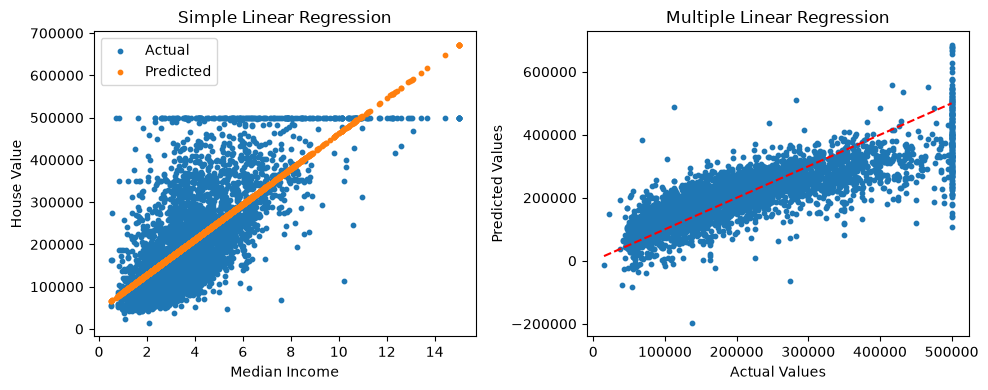
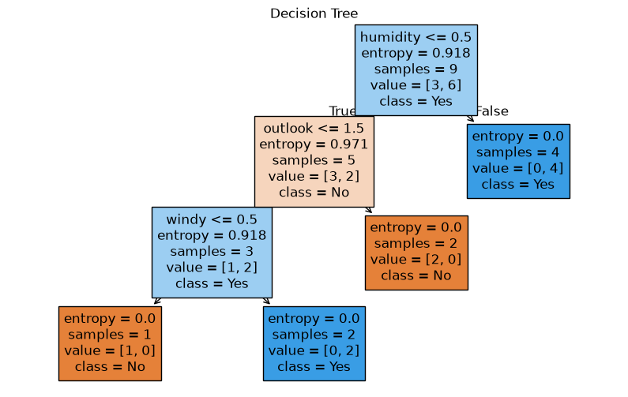
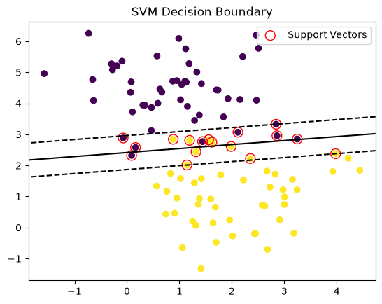
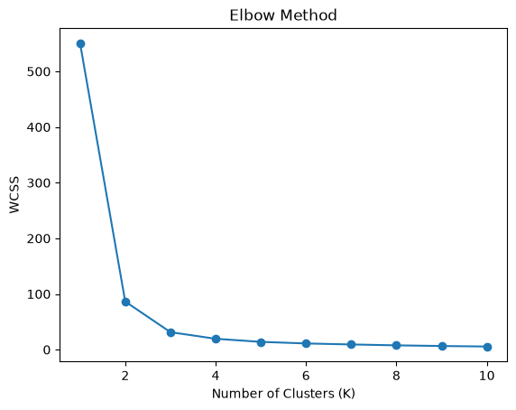
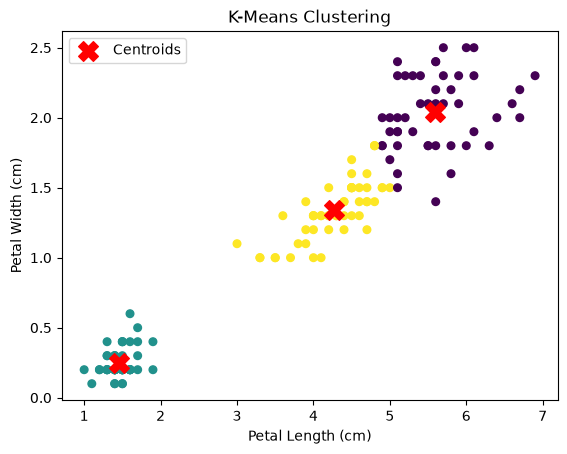
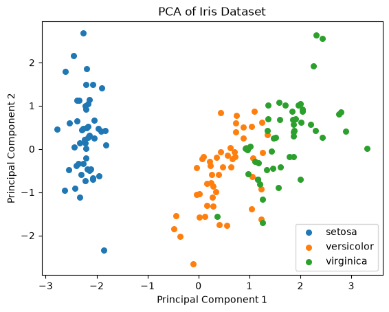

# AIML Lab - Google Colab Programs

Seven AIML lab experiments. Each `.py` file has the **algorithm** as comments at the top, the **program**, and the **output** as comments at the bottom.

## How to run in Google Colab

1. Upload the files from [`datasets/`](datasets) to `My Drive/AIML LAB/` in Google Drive.
2. Open a new Colab notebook, paste one experiment file into a cell and run it.
3. Experiments 3, 4 and 5 ask permission to connect Google Drive - click **Allow**.

| No. | Experiment | File |
|---|---|---|
| 1 | A* Search Algorithm | [exp1_astar.py](exp1_astar.py) |
| 2 | Tic-Tac-Toe using Minimax | [exp2_tic_tac_toe_minimax.py](exp2_tic_tac_toe_minimax.py) |
| 3 | Linear and Multiple Linear Regression | [exp3_linear_regression.py](exp3_linear_regression.py) |
| 4 | Decision Tree and Random Forest | [exp4_decision_tree_random_forest.py](exp4_decision_tree_random_forest.py) |
| 5 | Support Vector Machine (SVM) | [exp5_svm.py](exp5_svm.py) |
| 6 | K-Means Clustering and Elbow Method | [exp6_kmeans_elbow.py](exp6_kmeans_elbow.py) |
| 7 | Principal Component Analysis (PCA) | [exp7_pca.py](exp7_pca.py) |

---

## Experiment 1: A* Search Algorithm

No dataset needed.

### Algorithm

```text
1. Represent the graph with edge costs and a heuristic value h(n) for every node.
2. Put the start node in the open list with g = 0 and f = g + h.
3. Remove the node with the smallest f value from the open list.
4. If this node is the goal, return the path and its total cost.
5. Otherwise mark it as visited and, for every neighbour, find
   g = cost so far + edge cost and f = g + h, and add it to the open list.
6. Repeat steps 3-5 until the goal is reached or the open list is empty.
```

### Program

```python
import heapq

# 1. Graph (node -> list of (neighbour, cost)) and heuristic values
graph = {
    "A": [("B", 1), ("C", 3)],
    "B": [("D", 3), ("E", 1)],
    "C": [("F", 5)],
    "D": [("G", 2)],
    "E": [("G", 5)],
    "F": [("G", 2)],
    "G": []
}

h = {"A": 5, "B": 4, "C": 4, "D": 2, "E": 3, "F": 2, "G": 0}

def a_star(start, goal):
    # 2. Open list stores (f, g, node, path)
    open_list = [(h[start], 0, start, [start])]
    visited = []

    while open_list:
        # 3. Node with the smallest f value
        f, g, node, path = heapq.heappop(open_list)
        print("Visiting", node, " g =", g, " h =", h[node], " f =", f)

        # 4. Goal check
        if node == goal:
            return path, g

        if node in visited:
            continue
        visited.append(node)

        # 5. Add neighbours to the open list
        for neighbour, cost in graph[node]:
            if neighbour not in visited:
                new_g = g + cost
                new_f = new_g + h[neighbour]
                heapq.heappush(open_list, (new_f, new_g, neighbour, path + [neighbour]))

    return None, 0

# 6. Run A* from A to G
path, cost = a_star("A", "G")
print("\nShortest Path:", " -> ".join(path))
print("Total Cost:", cost)
```

### Output

```text
Visiting A  g = 0  h = 5  f = 5
Visiting B  g = 1  h = 4  f = 5
Visiting E  g = 2  h = 3  f = 5
Visiting D  g = 4  h = 2  f = 6
Visiting G  g = 6  h = 0  f = 6

Shortest Path: A -> B -> D -> G
Total Cost: 6
```

---

## Experiment 2: Tic-Tac-Toe using Minimax

No dataset needed. Sample game shown below.

### Algorithm

```text
1. Create an empty 3x3 board. The player is "X" and the computer is "O".
2. Display the board and take the player's move (1-9); reject invalid moves.
3. After every move, check for a win or a draw.
4. For the computer's turn, try every empty cell and score it using Minimax:
   +1 if the computer wins, -1 if the player wins, 0 for a draw.
5. Minimax assumes the computer picks the maximum score and the player
   picks the minimum score; the computer plays the cell with the best score.
6. Repeat steps 2-5 until someone wins or the board is full.
```

### Program

```python
# 1. Empty board
board = [" "] * 9

def show():
    for i in range(0, 9, 3):
        print(board[i], "|", board[i+1], "|", board[i+2])
        if i < 6:
            print("--+---+--")
    print()

def winner(p):
    lines = [
        (0, 1, 2), (3, 4, 5), (6, 7, 8),   # rows
        (0, 3, 6), (1, 4, 7), (2, 5, 8),   # columns
        (0, 4, 8), (2, 4, 6)               # diagonals
    ]
    return any(all(board[i] == p for i in line) for line in lines)

# 4-5. Minimax
def minimax(is_computer):
    if winner("O"):
        return 1
    if winner("X"):
        return -1
    if " " not in board:
        return 0

    scores = []
    for i in range(9):
        if board[i] == " ":
            board[i] = "O" if is_computer else "X"
            scores.append(minimax(not is_computer))
            board[i] = " "

    return max(scores) if is_computer else min(scores)

def best_move():
    best_score, move = -2, None
    for i in range(9):
        if board[i] == " ":
            board[i] = "O"
            score = minimax(False)
            board[i] = " "
            if score > best_score:
                best_score, move = score, i
    return move

# 6. Game loop
while True:
    # 2. Player move
    show()
    move = input("Enter position (1-9): ")

    if not move.isdigit() or int(move) < 1 or int(move) > 9 or board[int(move) - 1] != " ":
        print("Invalid position! Try again.\n")
        continue

    board[int(move) - 1] = "X"

    # 3. Check result
    if winner("X"):
        show()
        print("You win!")
        break
    if " " not in board:
        show()
        print("Draw!")
        break

    # 4-5. Computer move
    pos = best_move()
    board[pos] = "O"
    print("Computer chose position", pos + 1)

    if winner("O"):
        show()
        print("Computer wins!")
        break
```

### Output

```text
  |   |  
--+---+--
  |   |  
--+---+--
  |   |  

Enter position (1-9): 5
Computer chose position 1
O |   |  
--+---+--
  | X |  
--+---+--
  |   |  

Enter position (1-9): 1
Invalid position! Try again.

O |   |  
--+---+--
  | X |  
--+---+--
  |   |  

Enter position (1-9): 9
Computer chose position 3
O |   | O
--+---+--
  | X |  
--+---+--
  |   | X

Enter position (1-9): abc
Invalid position! Try again.

O |   | O
--+---+--
  | X |  
--+---+--
  |   | X

Enter position (1-9): 8
Computer chose position 2
O | O | O
--+---+--
  | X |  
--+---+--
  | X | X

Computer wins!
```

---

## Experiment 3: Linear and Multiple Linear Regression

Dataset: `housing.csv`

### Algorithm

```text
1. Import the required libraries and load housing.csv; remove missing values.
2. Select median_house_value as the target (y).
3. Simple Linear Regression: use only median_income as input, split, train, predict.
4. Multiple Linear Regression: use all numeric columns as input, split, train, predict.
5. Display actual vs predicted values and the R2 score of both models.
6. Plot graphs to compare actual and predicted house values.
```

### Program

```python
import pandas as pd
import matplotlib.pyplot as plt
from sklearn.model_selection import train_test_split
from sklearn.linear_model import LinearRegression
from sklearn.metrics import r2_score

# Connect Google Drive (to read the CSV file)
from google.colab import drive
drive.mount("/content/drive")

# 1. Load dataset
df = pd.read_csv("/content/drive/MyDrive/AIML LAB/housing.csv")
df = df.dropna()

print("Sample Data:")
print(df.head())

# 2. Target
y = df["median_house_value"]

# 3. Simple Linear Regression (one input)
X1 = df[["median_income"]]
X1_train, X1_test, y1_train, y1_test = train_test_split(X1, y, test_size=0.2, random_state=42)

model1 = LinearRegression()
model1.fit(X1_train, y1_train)
pred1 = model1.predict(X1_test)

# 4. Multiple Linear Regression (many inputs)
X2 = df.select_dtypes(include="number").drop(columns=["median_house_value"])
X2_train, X2_test, y2_train, y2_test = train_test_split(X2, y, test_size=0.2, random_state=42)

model2 = LinearRegression()
model2.fit(X2_train, y2_train)
pred2 = model2.predict(X2_test)

# 5. Results
print("\nSimple Regression R2 Score  :", round(r2_score(y1_test, pred1), 2))
print("Multiple Regression R2 Score:", round(r2_score(y2_test, pred2), 2))

print("\nActual vs Predicted (Multiple Regression):")
print(pd.DataFrame({"Actual": y2_test[:10].values, "Predicted": pred2[:10].round(0)}))

# 6. Plot graphs
plt.figure(figsize=(10, 4))

plt.subplot(1, 2, 1)
plt.scatter(X1_test, y1_test, s=10, label="Actual")
plt.scatter(X1_test, pred1, s=10, label="Predicted")
plt.title("Simple Linear Regression")
plt.xlabel("Median Income")
plt.ylabel("House Value")
plt.legend()

plt.subplot(1, 2, 2)
plt.scatter(y2_test, pred2, s=10)
plt.plot([y2_test.min(), y2_test.max()], [y2_test.min(), y2_test.max()], "r--")
plt.title("Multiple Linear Regression")
plt.xlabel("Actual Values")
plt.ylabel("Predicted Values")

plt.tight_layout()
plt.show()
```

### Output

```text
Mounted at /content/drive
Sample Data:
   longitude  latitude  ...  median_house_value  ocean_proximity
0    -122.23     37.88  ...            452600.0         NEAR BAY
1    -122.22     37.86  ...            358500.0         NEAR BAY
2    -122.24     37.85  ...            352100.0         NEAR BAY
3    -122.25     37.85  ...            341300.0         NEAR BAY
4    -122.25     37.85  ...            342200.0         NEAR BAY

[5 rows x 10 columns]

Simple Regression R2 Score  : 0.47
Multiple Regression R2 Score: 0.64

Actual vs Predicted (Multiple Regression):
     Actual  Predicted
0  245800.0   197058.0
1  137900.0   157509.0
2  218200.0   202099.0
3  220800.0   173502.0
4  170500.0   213795.0
5   75000.0   108005.0
6  269400.0   284796.0
7  228900.0   249129.0
8  500001.0   391339.0
9   80800.0    49301.0
```



---

## Experiment 4: Decision Tree and Random Forest

Dataset: `PlayTennis.csv`

### Algorithm

```text
1. Import the required libraries and load PlayTennis.csv.
2. Convert text values (Sunny, Hot, Yes...) into numbers using Label Encoding.
3. Split the dataset into training and testing data.
4. Train a Decision Tree (entropy) and predict the test data.
5. Train a Random Forest (many decision trees, majority vote) and predict the test data.
6. Compare the accuracy of both models and draw the decision tree.
```

### Program

```python
import pandas as pd
import matplotlib.pyplot as plt
from sklearn.preprocessing import LabelEncoder
from sklearn.model_selection import train_test_split
from sklearn.tree import DecisionTreeClassifier, plot_tree
from sklearn.ensemble import RandomForestClassifier
from sklearn.metrics import accuracy_score

# Connect Google Drive (to read the CSV file)
from google.colab import drive
drive.mount("/content/drive")

# 1. Load dataset
df = pd.read_csv("/content/drive/MyDrive/AIML LAB/PlayTennis.csv")
print("Sample Data:")
print(df.head())

# 2. Label Encoding
for col in df.columns:
    df[col] = LabelEncoder().fit_transform(df[col])

print("\nPreprocessed Data:")
print(df.head())

# 3. Split features and target
X = df.drop("play", axis=1)
y = df["play"]

X_train, X_test, y_train, y_test = train_test_split(X, y, test_size=0.3, random_state=42)

# 4. Decision Tree
dt = DecisionTreeClassifier(criterion="entropy", random_state=42)
dt.fit(X_train, y_train)
dt_pred = dt.predict(X_test)

# 5. Random Forest
rf = RandomForestClassifier(n_estimators=100, criterion="entropy", random_state=42)
rf.fit(X_train, y_train)
rf_pred = rf.predict(X_test)

# 6. Compare results
print("\nActual Values:          ", list(y_test))
print("Decision Tree Predicted:", dt_pred.tolist())
print("Random Forest Predicted:", rf_pred.tolist())
print("\nDecision Tree Accuracy:", round(accuracy_score(y_test, dt_pred) * 100, 2), "%")
print("Random Forest Accuracy:", round(accuracy_score(y_test, rf_pred) * 100, 2), "%")

plt.figure(figsize=(10, 6))
plot_tree(dt, feature_names=list(X.columns), class_names=["No", "Yes"], filled=True)
plt.title("Decision Tree")
plt.show()
```

### Output

```text
Mounted at /content/drive
Sample Data:
    outlook  temp humidity   windy play
0     Sunny   Hot     High    Weak   No
1     Sunny   Hot     High  Strong   No
2  Overcast   Hot     High    Weak  Yes
3      Rain  Mild     High    Weak  Yes
4      Rain  Cool   Normal    Weak  Yes

Preprocessed Data:
   outlook  temp  humidity  windy  play
0        2     1         0      1     0
1        2     1         0      0     0
2        0     1         0      1     1
3        1     2         0      1     1
4        1     0         1      1     1

Actual Values:           [1, 1, 0, 1, 0]
Decision Tree Predicted: [1, 0, 0, 1, 1]
Random Forest Predicted: [1, 0, 0, 1, 1]

Decision Tree Accuracy: 60.0 %
Random Forest Accuracy: 60.0 %
```



---

## Experiment 5: Support Vector Machine (SVM)

Dataset: `winequality-red.csv`

### Algorithm

```text
1. Import the required libraries and load winequality-red.csv.
2. Select the input features (X) and the target "quality" (y).
3. Split the dataset into training and testing data.
4. Scale the features and train the SVM model.
5. Predict the test data and display the confusion matrix and classification report.
6. Plot an SVM decision boundary with support vectors using sample 2D data.
```

### Program

```python
import numpy as np
import pandas as pd
import matplotlib.pyplot as plt
from sklearn.model_selection import train_test_split
from sklearn.svm import SVC
from sklearn.preprocessing import StandardScaler
from sklearn.metrics import confusion_matrix, classification_report, accuracy_score
from sklearn.datasets import make_blobs

# Connect Google Drive (to read the CSV file)
from google.colab import drive
drive.mount("/content/drive")

# 1. Load dataset
df = pd.read_csv("/content/drive/MyDrive/AIML LAB/winequality-red.csv")
print("Sample Data:")
print(df.head())

# 2. Features and target
X = df.drop("quality", axis=1)
y = df["quality"]

# 3. Split dataset
X_train, X_test, y_train, y_test = train_test_split(X, y, test_size=0.2, random_state=42)

# 4. Scale the features and train SVM
scaler = StandardScaler()
X_train = scaler.fit_transform(X_train)
X_test = scaler.transform(X_test)

model = SVC()
model.fit(X_train, y_train)

# 5. Predict and evaluate
y_pred = model.predict(X_test)

print("\nAccuracy:", round(accuracy_score(y_test, y_pred) * 100, 2), "%")
print("\nConfusion Matrix:")
print(confusion_matrix(y_test, y_pred))
print("\nClassification Report:")
print(classification_report(y_test, y_pred, zero_division=0))

print("Actual vs Predicted:")
print(pd.DataFrame({"Actual": y_test.values, "Predicted": y_pred}).head(10))

# 6. Plot SVM decision boundary (sample 2D data)
X2, y2 = make_blobs(n_samples=100, centers=2, random_state=0)
svm = SVC(kernel="linear").fit(X2, y2)

plt.scatter(X2[:, 0], X2[:, 1], c=y2)
plt.scatter(svm.support_vectors_[:, 0], svm.support_vectors_[:, 1],
            s=100, facecolors="none", edgecolors="red", label="Support Vectors")

xx, yy = np.meshgrid(np.linspace(*plt.xlim(), 100), np.linspace(*plt.ylim(), 100))
Z = svm.decision_function(np.c_[xx.ravel(), yy.ravel()]).reshape(xx.shape)
plt.contour(xx, yy, Z, levels=[-1, 0, 1], colors="k", linestyles=["--", "-", "--"])

plt.title("SVM Decision Boundary")
plt.legend()
plt.show()
```

### Output

```text
Mounted at /content/drive
Sample Data:
   fixed acidity  volatile acidity  citric acid  ...  sulphates  alcohol  quality
0            7.4              0.70         0.00  ...       0.56      9.4        5
1            7.8              0.88         0.00  ...       0.68      9.8        5
2            7.8              0.76         0.04  ...       0.65      9.8        5
3           11.2              0.28         0.56  ...       0.58      9.8        6
4            7.4              0.70         0.00  ...       0.56      9.4        5

[5 rows x 12 columns]

Accuracy: 60.31 %

Confusion Matrix:
[[ 0  0  1  0  0  0]
 [ 0  0  8  2  0  0]
 [ 0  0 99 31  0  0]
 [ 0  0 43 85  4  0]
 [ 0  0  1 32  9  0]
 [ 0  0  0  2  3  0]]

Classification Report:
              precision    recall  f1-score   support

           3       0.00      0.00      0.00         1
           4       0.00      0.00      0.00        10
           5       0.65      0.76      0.70       130
           6       0.56      0.64      0.60       132
           7       0.56      0.21      0.31        42
           8       0.00      0.00      0.00         5

    accuracy                           0.60       320
   macro avg       0.30      0.27      0.27       320
weighted avg       0.57      0.60      0.57       320

Actual vs Predicted:
   Actual  Predicted
0       6          5
1       5          5
2       6          6
3       5          5
4       6          6
5       5          5
6       5          5
7       5          5
8       5          6
9       6          6
```



---

## Experiment 6: K-Means Clustering and Elbow Method

Dataset: Iris (built into sklearn)

### Algorithm

```text
1. Import the required libraries and load the Iris dataset (built into sklearn).
2. Select two features (petal length and petal width) for clustering.
3. Run K-Means for K = 1 to 10 and store the WCSS (inertia) for each K.
4. Plot the Elbow graph and choose the K where the curve bends (K = 3).
5. Train K-Means with K = 3 and assign a cluster to every data point.
6. Plot the clusters and their centroids.
```

### Program

```python
import pandas as pd
import matplotlib.pyplot as plt
from sklearn.datasets import load_iris
from sklearn.cluster import KMeans

# 1. Load dataset
iris = load_iris()
df = pd.DataFrame(iris.data, columns=iris.feature_names)
print("Sample Data:")
print(df.head())

# 2. Select features
X = df[["petal length (cm)", "petal width (cm)"]]

# 3. Find WCSS for K = 1 to 10
wcss = []
for k in range(1, 11):
    km = KMeans(n_clusters=k, n_init=10, random_state=42)
    km.fit(X)
    wcss.append(km.inertia_)

# 4. Elbow graph
plt.plot(range(1, 11), wcss, marker="o")
plt.title("Elbow Method")
plt.xlabel("Number of Clusters (K)")
plt.ylabel("WCSS")
plt.show()

# 5. Train K-Means with K = 3
model = KMeans(n_clusters=3, n_init=10, random_state=42)
df["Cluster"] = model.fit_predict(X)

print("\nClustered Data:")
print(df.head())
print("\nCluster Centers:")
print(model.cluster_centers_)

# 6. Plot clusters and centroids
plt.scatter(X.iloc[:, 0], X.iloc[:, 1], c=df["Cluster"], s=30)
plt.scatter(model.cluster_centers_[:, 0], model.cluster_centers_[:, 1],
            c="red", marker="X", s=200, label="Centroids")
plt.title("K-Means Clustering")
plt.xlabel("Petal Length (cm)")
plt.ylabel("Petal Width (cm)")
plt.legend()
plt.show()
```

### Output

```text
Sample Data:
   sepal length (cm)  sepal width (cm)  petal length (cm)  petal width (cm)
0                5.1               3.5                1.4               0.2
1                4.9               3.0                1.4               0.2
2                4.7               3.2                1.3               0.2
3                4.6               3.1                1.5               0.2
4                5.0               3.6                1.4               0.2

Clustered Data:
   sepal length (cm)  sepal width (cm)  ...  petal width (cm)  Cluster
0                5.1               3.5  ...               0.2        1
1                4.9               3.0  ...               0.2        1
2                4.7               3.2  ...               0.2        1
3                4.6               3.1  ...               0.2        1
4                5.0               3.6  ...               0.2        1

[5 rows x 5 columns]

Cluster Centers:
[[5.59583333 2.0375    ]
 [1.462      0.246     ]
 [4.26923077 1.34230769]]
```





---

## Experiment 7: Principal Component Analysis (PCA)

Dataset: Iris (built into sklearn)

### Algorithm

```text
1. Import the required libraries and load the Iris dataset (4 features).
2. Standardize the features so that each has mean 0 and variance 1.
3. Apply PCA to reduce the 4 features to 2 principal components.
4. Display the explained variance ratio of each component.
5. Display the data before and after reduction.
6. Plot the data on the two principal components.
```

### Program

```python
import pandas as pd
import matplotlib.pyplot as plt
from sklearn.datasets import load_iris
from sklearn.preprocessing import StandardScaler
from sklearn.decomposition import PCA

# 1. Load dataset
iris = load_iris()
X = pd.DataFrame(iris.data, columns=iris.feature_names)
y = iris.target

print("Original Data (4 features):")
print(X.head())
print("Shape:", X.shape)

# 2. Standardize
X_scaled = StandardScaler().fit_transform(X)

# 3. Apply PCA
pca = PCA(n_components=2)
X_pca = pca.fit_transform(X_scaled)

# 4. Explained variance
print("\nExplained Variance Ratio:", pca.explained_variance_ratio_.round(3))
print("Total Variance Kept:", round(sum(pca.explained_variance_ratio_) * 100, 2), "%")

# 5. Reduced data
df_pca = pd.DataFrame(X_pca, columns=["PC1", "PC2"]).round(3)
print("\nData after PCA (2 features):")
print(df_pca.head())
print("Shape:", df_pca.shape)

# 6. Plot
for label, name in enumerate(iris.target_names):
    plt.scatter(X_pca[y == label, 0], X_pca[y == label, 1], label=name, s=30)

plt.title("PCA of Iris Dataset")
plt.xlabel("Principal Component 1")
plt.ylabel("Principal Component 2")
plt.legend()
plt.show()
```

### Output

```text
Original Data (4 features):
   sepal length (cm)  sepal width (cm)  petal length (cm)  petal width (cm)
0                5.1               3.5                1.4               0.2
1                4.9               3.0                1.4               0.2
2                4.7               3.2                1.3               0.2
3                4.6               3.1                1.5               0.2
4                5.0               3.6                1.4               0.2
Shape: (150, 4)

Explained Variance Ratio: [0.73  0.229]
Total Variance Kept: 95.81 %

Data after PCA (2 features):
     PC1    PC2
0 -2.265  0.480
1 -2.081 -0.674
2 -2.364 -0.342
3 -2.299 -0.597
4 -2.390  0.647
Shape: (150, 2)
```


